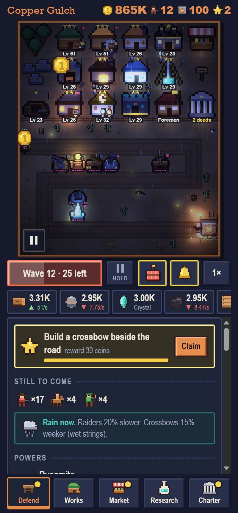
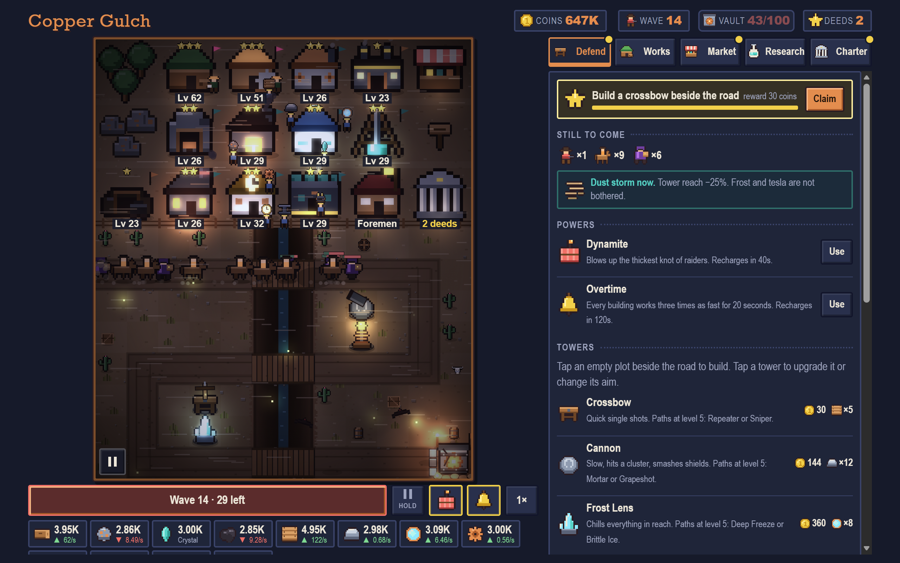

# Copper Gulch

A tycoon, tower defence and incremental game in one page. Gather timber and ore, build a chain of workshops up to clockwork automatons, sell goods or fill caravan contracts, and spend it all on towers that keep raiders away from the vault.

**Play it: https://jonathanwessel.github.io/tycoon/**

No ads, no purchases, no tracking. The page makes no requests to any other site, and your game is saved only in your own browser.

  
  

## What is in it

- Twelve buildings and twelve goods, with output doubling at milestone levels and foremen who upgrade buildings for you.
- Five towers, each with two upgrade paths and a choice of target, against seven kinds of raider and a war wagon every tenth wave.
- Weather that changes the fight: dust storms, rain, heat waves and clear nights.
- Moving market prices, caravan contracts, research, goals and badges.
- Charters to start over with deeds and perks, across three maps: Copper Gulch, Forked Canyon and Trestle Bridge.
- Pixel art lit by a small hand-written WebGL engine: a moving sun with cast shadows, drifting clouds, lamps, forges, muzzle flashes and explosions that light the ground, and dusk falling as raiders arrive. A simple mode is there for slower devices.
- Install it as an app from your browser (Install app / Add to Home Screen). It works offline and updates itself when a new version is published.
- Works on phones and computers, keeps working for up to 8 hours while you are away, and can hold waves or pause completely.

## Running it locally

Open `index.html` in a browser. There is no build step and nothing to install.

## Checks

Both scripts need Node 22 or newer. They use Playwright if it is installed, and otherwise drive an installed Edge or Chrome directly (`scripts/cdp.js`); set `CHROME_PATH` to pick a browser.

- `node scripts/smoke.js [screenshot-dir]` plays through every tower, raider, power and screen at phone and desktop sizes and fails on errors or broken layout.
- `node scripts/balance.js [minutes] [runs]` lets a bot play the real game logic and reports how long each milestone takes.

`PLAN.md` describes how the code is laid out and what is planned next.
